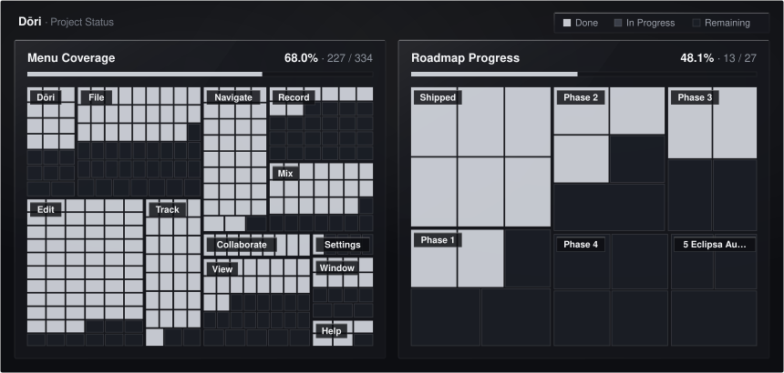

<p align="center"></p>

<h1 align="center">Dōri</h1>

<p align="center"><b>A pure-Rust digital audio workstation built Linux-first with cross-platform desktop support.</b></p>

<p align="center">Sample-accurate transport, MIDI and audio editing, a Piano Roll, a 64-bit Mixer with real-time DSP effects and automation, and a lock-free audio engine — rendered with <code>egui</code> (<code>wgpu</code>/Vulkan) and played through <code>cpal</code> (PipeWire/ALSA, WASAPI/ASIO, CoreAudio), without Electron or JUCE.</p>

<p align="center"><i>Named after the Japanese <b>dōri</b> (道理)</i></p>

<p align="center">
  <a href="https://github.com/triadwoozie/douri/releases/latest">
    
  </a>
</p>

<p align="center">
  <a href="#features">Features</a> •
  <a href="#quick-start">Quick Start</a> •
  <a href="#sound-libraries">Sound Libraries</a> •
  <a href="#architecture">Architecture</a> •
  <a href="ROADMAP.md">Roadmap</a> •
  <a href="docs/RELEASING.md">Releasing</a> •
  <a href="AGENTS.md">Contributing</a> •
  <a href="#credits--license">Credits & License</a>
</p>


<table>
  <tr>
    <td></td>
    <td></td>
  </tr>
  <tr>
    <td align="center">Piano Roll with quantize and velocity lane</td>
    <td align="center">Playback with live channel meters</td>
  </tr>
</table>

## Status

Counted directly from source (`menus::enabled` and `ROADMAP.md`). Run `cargo xtask status` to regenerate.

<!-- status:start (made by `cargo xtask status`) -->
<div align="center">



| | Done | Started | Total | Done % |
| --- | ---: | ---: | ---: | ---: |
| Menu entries | 229 | 0 | 335 | 68.36% |
| Roadmap items | 15 | 2 | 27 | 55.56% |

</div>
<!-- status:end -->

> **Note:** Dōri is alpha software (`v0.1.0-alpha.10`). Keep backups of your `.douri` projects while the format evolves.

## Features

- **Lock-Free Audio Engine:** Zero-allocation real-time path (`#![forbid(alloc)]` + `assert_no_alloc`), 64-bit summing bus, sample-accurate PDC, PipeWire-native JACK & quantum diagnostics, native Windows ASIO / `IAudioClient3` WASAPI, and loopback latency calibration.
- **Arranging & Editing:** Multi-track arranger (Audio, Instrument, Drummer, Pattern, Aux, VCA, Folder, External MIDI), Marquee selection, gap-free snap grid, Option/Alt-drag duplication, Take Folders, Per-Note PSOLA Pitch Editor, and autosave crash recovery.
- **MIDI & Scoring:** Piano Roll (swing/scale quantize, velocity/CC lanes), Step Sequencer, Event List, MIDI FX chain (including sandboxed Rhai **Scripter**), and Score Editor with MusicXML export.
- **Built-In Instruments:** Transient-Slicing Sampler (`Pads` / `Slices` / `Instrument` with interactive ADSR), Modal Voice, TripleOscillator (`TriOsc`), WaveDraw wavetable synth, 808 Bass, Subtractive Synth, Electric Piano, Tonewheel Organ, velocity-metered Drum Machine, and `.exs`/`.sfz`/`.sf2` playback.
- **DSP Effects, Stem Splitter & Metering:** Multi-model Compressor, Pult EQ, 8-band Channel EQ, Convolution Reverb, Lemon Studio Dynamics, Bode Frequency Shifter, Auto-Pan, local AI **Stem Splitter**, and **MultiMeter** (ITU-R BS.1770-4 LUFS, 4× True Peak, 45° goniometer, IEC VU/PPM ballistics).
- **Mixing, Bounce & Interop:** 64-bit mixer with automation (`Read`/`Touch`/`Latch`/`Write`), offline bounce up to `500×` real-time with TPDF dithering, stem export, and `.logicx`/`.band`/`.h2song`/`.mid` import.
- **Plugins, UI & Automation:** CLAP/VST3/LADSPA/AU hosting with native X11/XWayland windows, Vulkan (`wgpu`) Liquid Glass UI, Command Palette, Modulation Matrix drawer, and built-in MCP server (`127.0.0.1:38420` / `--mcp-stdio`).

## Quick Start

### Prerequisites (Linux)

```bash
# Debian / Ubuntu / Pop!_OS / Linux Mint:
sudo apt-get update && sudo-get install -y pkg-config libasound2-dev libxkbcommon-dev libwayland-dev

# Fedora / Nobara / RHEL:
sudo dnf install -y pkgconf-pkg-config alsa-lib-devel libxkbcommon-devel wayland-devel

# Arch Linux / Manjaro:
sudo pacman -S --needed pkgconf alsa-lib libxkbcommon wayland
```

### Build & Run from Source

```bash
git clone https://github.com/triadwoozie/douri.git
cd douri

# Run Dōri in release mode
cargo run --release --bin douri

# Open a project or audio file directly
cargo run --release --bin douri -- my_project.douri
```

### Desktop Integration (Linux) & Verification

```bash
cargo build --release --bin douri
./dist/linux/install.sh          # install to ~/.local (--uninstall to remove)

cargo xtask check                # fmt, clippy, workspace tests, and rt-check
```

## Sound Libraries

- **SoundFonts (`.sf2`):** Drop `.sf2` files into `~/.local/share/soundfonts/` or load via **Inspector > SoundFont > Load SoundFont…**.
- **EXS & SFZ:** Select **Sampler** in the track Inspector and choose **Load SFZ Instrument…** or **Load EXS Instrument…**.
- **Impulse Responses:** Open **Convolution Reverb** and choose **Load Impulse Response File…** (`.wav`, `.aiff`, `.flac`).

## Architecture

| Crate | Purpose |
| --- | --- |
| [`crates/prowave-engine`](crates/prowave-engine) | Lock-free audio engine, 64-bit mixer, offline bounce, EBU R128 metering, synths, DSP, `cpal` output |
| [`crates/prowave-app`](crates/prowave-app) | `egui` desktop UI, Piano Roll, Mixer, MultiMeter, Stem Splitter, MCP server |
| [`crates/prowave-project`](crates/prowave-project) | `.douri` zip project serializer with `.prowave` compatibility |
| [`crates/prowave-plugin-host`](crates/prowave-plugin-host) | In-process and out-of-process CLAP, VST3, LADSPA, and AU hosting |
| [`crates/prowave-logicx-import`](crates/prowave-logicx-import) | `.logicx` project bundle importer |
| [`crates/prowave-garageband-import`](crates/prowave-garageband-import) | `.band` project bundle importer |
| [`crates/prowave-exs`](crates/prowave-exs) | `.exs` multisample instrument parser |
| [`crates/prowave-sfz`](crates/prowave-sfz) | `.sfz` instrument format reader |
| [`xtask`](xtask) | `cargo xtask check`, `rt-check`, `status`, `package-installers`, `package-rpm` |

## Credits & License

Copyright (C) 2026 Dōri contributors. Original work Copyright (C) 2026 Pro-Wave contributors.

Dōri is free software licensed under the **GNU General Public License v3.0 or later** (**GPL-3.0-or-later**). Per **Section 5 of GPLv3**, Dōri attributes and builds upon:

- **[fabox-os/Pro-Wave](https://github.com/fabox-os/Pro-Wave)** (GPL-3.0-or-later): Upstream DAW architecture, lock-free engine, egui UI, and DSP effects.
- **[transit-audio/transit](https://github.com/transit-audio/transit)** (MIT / Apache-2.0): Windows ASIO/WASAPI backends, PipeWire discovery, privacy-redacted diagnostics, latency calibrator, Modal Voice, and Compressor.
- **[LMMS/lmms](https://github.com/LMMS/lmms)** (GPL-2.0-or-later): TripleOscillator (`TriOsc`), WaveDraw wavetable synth, Peak Follower & LFO modulators, and CC-0 waveforms (`shapes/`).
- **[yuribeats/prowave](https://github.com/yuribeats/prowave)** (GPL-3.0-or-later): Arranging tools (Marquee, snap grid, Option-drag), crash recovery, and 808 Bass synth.
- **[storytold/soundcraft](https://github.com/storytold/soundcraft)** (MIT / Apache-2.0): Offline mixdown architecture, TPDF dither, and ITU-R BS.1770 / EBU R128 metering.
- **[Ardour](https://github.com/Ardour/ardour)** (GPL-2.0-or-later): Hardware MIDI patch definitions (`.midnam`) and Scala microtonal tuning references.
- **[DAW UI Design](https://www.figma.com/community/file/1240550915764011777/daw-ui-design)** (CC BY 4.0, Dicky Jiang): Flat-bevel vector rotary knob styling.
- **[webaudio-controls](https://github.com/g200kg/webaudio-controls)** (Apache-2.0, g200kg et al.): Hardware rotary, slider, and keyboard control ergonomics.
- **[ouestlabs/audio-ui](https://github.com/ouestlabs/audio-ui)** (MIT License, Ouest Labs): IEC VU/PPM meter ballistics, 45° Mid/Side stereo goniometer, interactive ADSR envelope, and velocity-metered pad styling.
- **[Phosphor Icons](https://phosphoricons.com/)** (MIT License, Helena Zhang & Tobias Fried): Vector studio icons via `phosphor-egui`.

See [`THIRD_PARTY_LICENSES.md`](THIRD_PARTY_LICENSES.md) for full attributions and [`LICENSE`](LICENSE) for complete license terms.

Dōri is an independent open-source project and is not affiliated with, sponsored by, or endorsed by Apple Inc. `.logicx`, `.band`, and `.exs` are referenced solely to describe file format compatibility.
