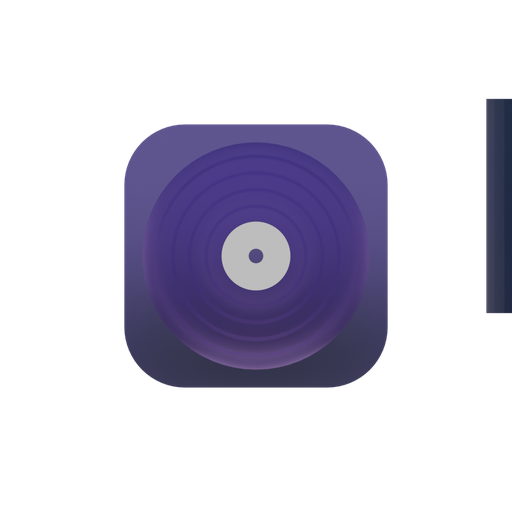

<p align="center"></p>

<h1 align="center">Dōri</h1>

<p align="center"><b>A pure-Rust + egui digital audio workstation targeting Linux-first with cross-platform desktop support, inspired by Logic Pro.</b></p>

<p align="center">Sample-accurate transport, MIDI and audio editing, a comprehensive Piano Roll, a responsive Mixer with real DSP effects and automation, and a lock-free real-time audio engine. Rendered cleanly with egui, played through cpal (PipeWire/ALSA on Linux, WASAPI on Windows, CoreAudio on macOS): no Electron, no JUCE.</p>

<p align="center"><i>Named after the Japanese <b>dōri</b> (道理)</i></p>

<p align="center">
  
  
  
</p>

<p align="center">
  <a href="#features">Features</a> •
  <a href="#quick-start">Quick Start</a> •
  <a href="#sound-libraries">Sound Libraries</a> •
  <a href="#architecture">Architecture</a> •
  <a href="AUDIT_AND_PLAN.md">Audit & Plan</a> •
  <a href="ROADMAP.md">Roadmap</a> •
  <a href="AGENTS.md">Contributing</a> •
  <a href="#credits--license">Credits & License</a>
</p>


<table>
  <tr>
    <td></td>
    <td></td>
  </tr>
  <tr>
    <td align="center">Piano Roll with quantize and velocity lane</td>
    <td align="center">Playback with live channel meters</td>
  </tr>
</table>

Dōri is an independent open-source project based on [fabox-os/Pro-Wave](https://github.com/fabox-os/Pro-Wave). It is not affiliated with, sponsored by, or endorsed by Apple Inc. Logic Pro is a trademark of Apple Inc., referenced solely for clean-room workflow, UI layout, and parameter alignment. Dōri contains no proprietary Apple code, artwork, or audio assets.

---

## Features

### Real-Time Engine & Strict Audio Safety
- **Lock-free audio engine**: Sample-accurate transport with cycle looping, metronome, count-in, and full tempo and time signature mapping (supporting complex meters like 6/8 and 7/8).
- **Zero audio-thread allocation**: Audio processing paths strictly guarantee `#![forbid(alloc)]` and `assert_no_alloc` safety — no allocations, no mutexes, and no blocking I/O on the real-time thread.
- **64-bit float summing & Plug-in Delay Compensation (PDC)**: True 64-bit precision summing bus with automatic sample-accurate delay compensation across all tracks and effect chains.

### Arranging & Editing (Milestones 1 & 2)
- **Flex Pitch Per-Note Editor**: Interactive piano-roll vocal and melodic pitch editor for monophonic audio regions, featuring fine pitch cent adjustments, entry/exit pitch drift curves, vibrato modulation depth, formant shift, note gain leveling, scale quantization ("Snap to Scale"), and "Create MIDI Track from Flex Pitch" using pure-Rust PSOLA resynthesis.
- **Marquee Selection Tool**: Logic-style marquee tool for precision time-slice selection, Marquee split (`Cmd/Ctrl+T`), and marquee region drag/delete.
- **Gap-Free Snap Grid**: Smart musical snapping to bars, beats, and division intervals preventing unintended micro-gaps and overlaps.
- **Option/Alt-Drag Duplication**: Fast region cloning in the tracks area with Alt/Option-drag.
- **Autosave & Crash Recovery**: Periodic background state snapshotting with automatic session restoration prompts on startup.
- **Multi-Track Arranger**: Audio, Instrument, Drummer, Pattern, Aux, VCA, Folder, and External MIDI tracks. Move, repeat, cut, copy, paste, split, join, bounce in place, and bounce & join with infinite undo history.

### Instruments & Sound Engines
- **Apple EXS24 & SFZ Sampler**: Multi-zone sample playback engine loading binary Apple EXS24 (`.exs`) instruments and SFZ format with 4-point cubic resampling, velocity layering, choke groups, and automatic sample resolution across project folders and the user Sound Library path.
- **Sound Library Management**: Configurable Sound Library root path under **Project Settings > General** with automatic fallback searches for `.caf`, `.aif`, `.aiff`, `.wav`, and other standard sample formats.
- **808 Bass Synthesizer**: Pure sine-drop sub-bass synth engine with glide, tune, and saturation controls (`bass808.rs`).
- **SoundFont Player**: Built-in `.sf2` player supporting multi-sampled SoundFont instruments with velocity layers and filter envelopes.
- **Physically Modelled Electric Piano**: Reed-based physical model (Wurlitzer 200A style) with non-linear pickup saturation, tremolo, and tone bark.
- **Vintage B3 Organ**: Additive drawbar organ with nine drawbars (16' to 1'), percussion harmonics, key click, and Leslie speaker simulation.
- **Drum Machine**: 16-pad drum synthesizer (Kick, Snare, Hi-Hats, Toms, Claps) and custom sample loader with choke groups.
- **Subtractive Synthesizer**: 48-voice virtual analog polyphonic synthesizer with resonant filters and modulation routing.

### Built-In DSP Effects & Metering
- **Lemon Studio Dynamics & Color Effects**:
  - **Lemon Limiter**: Transparent lookahead peak limiter with transient punch.
  - **Lemon Soft Clipper**: Analog warmth and saturating soft clipping.
  - **Lemon Fast Distortion**: Harmonic overdrive stage with dynamic bite.
  - **Lemon Transient Processor**: Precision attack and sustain shaper for drums and stems.
- **SoundCraft Audio FX**:
  - **Bode Frequency Shifter**: Zero-alloc single-sideband frequency shifter with feedback.
  - **Auto-Pan**: Zero-alloc stereo panning modulator with rate, depth, and LFO waveform control.
- **Logic Pro-Style MultiMeter**: Dedicated analyzer window (**Window > MultiMeter**) with:
  - ITU-R BS.1770-4 K-weighted LUFS metering: Momentary (400 ms), Short-term (3 s), and Gated Integrated LUFS (-70 LUFS / -10 LU gates) with streaming (-14 LUFS) and broadcast (-23 LUFS) reference markers.
  - 4× oversampled polyphase windowed sinc True Peak filter with inter-sample peak clip indicator.
- **Mixer Channel Strips**: Master and Stereo Out strips display live Integrated LUFS and True Peak values.
- **Pult EQ**: Pultec-style tube EQ with low boost/atten ("Pultec trick") and high boost/shelf saturation.
- **Space Designer Convolution Reverb**: Convolution reverb with volume & filter envelopes, X-over, output EQ, mastering presets, and custom impulse response (`.wav`/`.aiff`/`.flac`) loading.
- **Multi-Band Compressor & Dynamics**: Channel EQ, Multi-Band EQ, Compressor, Noise Gate, and Limiter.
- **Guitar & Bass Amp Designer**: Realistic amplifier and cabinet simulation with drive and tone controls.
- **Modulation & Delays**: Tape Delay, Stereo Chorus, Phaser, Overdrive, and Resonant Filters.

### Export & Project Interoperability
- **Faster-Than-Realtime Offline Bounce (Milestone 1)**: Headless freewheeling mixdown processing at CPU memory speeds (up to 500× real-time) for both full projects and cycle ranges.
- **Multi-Format WAV & TPDF Dithering (Milestone 1)**: 16-bit, 24-bit, and 32-bit float exports with Triangular Probability Density Function (TPDF) dithering via Xorshift32 PRNG (automatically bypassing digital silence). Atomic `.part` file writing ensures zero corrupted bounces.
- **Stem Export (Milestone 1)**: **File > Export > All Tracks as Audio Files…** for concurrent offline multi-track stem rendering.
- **Project Import**: Seamless import of Logic Pro `.logicx` bundles, GarageBand projects (audio), Hydrogen `.h2song` drum patterns, and standard MIDI files (`.mid`).
- **Score Editor & MusicXML**: Sheet music score view with key signatures, clefs, and MusicXML export.

### Plug-in Hosting & Management (Milestone 3)
- **Third-Party CLAP & VST3 Instrument Hosting**: Host software instrument synths and samplers alongside built-in instruments with zero audio-thread allocation MIDI event routing (Note On/Off, Pitch Bend, CC, Aftertouch, Sustain).
- **Native Linux Plugin Windows (X11 / XWayland)**: Dynamically embedded native GUI windows via `libloading` with zero compile-time X11 linker dependencies, full event loop handling, and double-click access from mixer channel strips and the track inspector.
- **Plug-In Manager & Custom Scan Paths**: Dedicated manager (**Settings > Plug-In Manager…** or **Window > Plugin Manager**) featuring real-time search, category filters (All / Instruments / Effects), format filters (CLAP, VST3, AU, LADSPA), status reporting (Working, Incompatible, Crashed), and custom scan directory configuration.

### Vulkan, Liquid Glass UI & MCP Server (Milestone 4)
- **Vulkan (`wgpu`) Graphics Backend**: Native Vulkan GPU rendering via `eframe` (`Renderer::Wgpu`) with automatic fallback to OpenGL (`Renderer::Glow`) in headless or CI environments.
- **Liquid Glass Floating Capsules**: Liquid Rust-inspired WGSL shader pipeline for floating capsules, utility dialogs, and top bar controls.
- **Matte Obsidian Workspace**: High-contrast dark palette (`#0D0F14` canvas, `#13161E` panels, `#1A1E29` cards/capsules) with radial-arc pan knobs and tactile faders.
- **Built-in Model Context Protocol (MCP) Server**: Zero-alloc real-time safe MCP bridge accessible over local TCP (`127.0.0.1:38420`) and `--mcp-stdio` CLI mode, supporting 4 live resources and 19 automation/control tools.

---

## Quick Start

### Prerequisites (Linux)

Install the required ALSA and system development packages:

```bash
# Debian / Ubuntu / Pop!_OS / Linux Mint:
sudo apt-get update && sudo apt-get install -y pkg-config libasound2-dev libxkbcommon-dev libwayland-dev

# Fedora / Nobara / RHEL:
sudo dnf install -y pkgconf-pkg-config alsa-lib-devel libxkbcommon-devel wayland-devel

# Arch Linux / Manjaro:
sudo pacman -S --needed pkgconf alsa-lib libxkbcommon wayland
```

### Build & Run from Source

```bash
# Clone the repository
git clone https://github.com/triadwoozie/douri.git
cd douri

# Run Dōri in release mode
cargo run --release --bin douri

# Open a specific project or audio file
cargo run --release --bin douri -- my_project.douri
cargo run --release --bin douri -- song_stems.wav
```

### Desktop Integration & Installation (Linux)

To install Dōri, its desktop launcher, MIME file types, and application icons to your user environment (`~/.local`):

```bash
# Build the release binary
cargo build --release --bin douri

# Run the install script (no root required)
./dist/linux/install.sh
```

To uninstall:
```bash
./dist/linux/install.sh --uninstall
```

### Running Tests & Audio Safety Verification

```bash
# Run workspace test suite
cargo test --workspace

# Run real-time audio thread allocation checks (strictly validates zero allocations)
cargo xtask rt-check

# Run full project checks
cargo xtask check
```

---

## Sound Libraries

Dōri supports loading sound fonts, sample libraries, and impulse responses:

- **SoundFonts (`.sf2`)**: Drop your `.sf2` files into `~/.local/share/soundfonts/` or load them directly via the track Inspector under **SoundFont > Load SoundFont…**.
- **EXS24 & SFZ Libraries**: In the track Inspector, select **SoundFont > Sampler** and choose **Load SFZ Instrument…** or **Load EXS Instrument…**.
- **Impulse Responses for Space Designer**: Open Space Designer from any Audio FX slot, click the IR menu, and choose **Load Impulse Response File…** (`.wav`, `.aiff`, or `.flac`).

---

## Architecture

| Crate | Purpose |
|---|---|
| [`crates/prowave-engine`](crates/prowave-engine) | Real-time audio engine: sample-accurate transport, lock-free queues, 64-bit mixer, offline freewheeling bounce, EBU R128 metering, synths, and cpal output |
| [`crates/prowave-app`](crates/prowave-app) | Desktop interface built in pure `egui`: tracks area, Piano Roll, Mixer, MultiMeter, and inspector |
| [`crates/prowave-project`](crates/prowave-project) | Project serializer & archive container (`.douri` zip package with full `.prowave` backward compatibility) |
| [`crates/prowave-plugin-host`](crates/prowave-plugin-host) | Out-of-process and in-process plugin hosting for CLAP, VST3, LADSPA, and AU |
| [`crates/prowave-logicx-import`](crates/prowave-logicx-import) | Parser for Apple Logic Pro `.logicx` packages and ProjectData structures |
| [`crates/prowave-garageband-import`](crates/prowave-garageband-import) | Parser for GarageBand `.band` projects |
| [`crates/prowave-exs`](crates/prowave-exs) | EXS24 sampler instrument parser: zones, groups, loops, and velocity layers |
| [`crates/prowave-sfz`](crates/prowave-sfz) | SFZ instrument format reader |
| [`xtask`](xtask) | Build tooling: `cargo xtask check`, `rt-check`, `bench`, and `wasm-check` |

---

## Credits & License

Copyright (C) 2026 Dōri contributors.  
Original work Copyright (C) 2026 Pro-Wave contributors.

Dōri is free software: you can redistribute it and/or modify it under the terms of the **GNU General Public License** as published by the Free Software Foundation, either version 3 of the License, or (at your option) any later version (**GPL-3.0-or-later**).

Per **Section 5 of the GNU General Public License v3**, Dōri explicitly attributes and builds upon the following open-source projects:

- **[fabox-os/Pro-Wave](https://github.com/fabox-os/Pro-Wave)** (GPL-3.0-or-later): Upstream core DAW architecture, real-time lock-free engine, egui user interface, and built-in DSP effects.
- **[yuribeats/prowave](https://github.com/yuribeats/prowave)** (GPL-3.0-or-later): Yuri's Version arranging tools (Marquee selection, snap grid, Option-drag), crash recovery, and 808 Bass synthesizer.
- **[storytold/soundcraft](https://github.com/storytold/soundcraft)** (MIT / Apache-2.0): Faster-than-realtime offline mixdown architecture, TPDF dither generator, and ITU-R BS.1770 / EBU R128 True Peak and loudness metering.
- **[stakira/OpenUtau](https://github.com/stakira/OpenUtau)** (MIT License): Open-source singing voice synthesis platform, phonemizer, and vocal synthesis architecture references.
- **[Ardour](https://github.com/Ardour/ardour)** (GPL-2.0-or-later): Hardware MIDI patch definition library (`.midnam`) and Scala microtonal tuning references.
- **[Phosphor Icons](https://phosphoricons.com/)** (MIT License, Helena Zhang & Tobias Fried): Clean vector studio icons via `phosphor-egui`.
- **Original 3D Artwork**: Blender-rendered Dōri studio app icon and 3D studio visual assets created by **triadwoozie**.

All original copyright notices and license texts have been retained. See [`THIRD_PARTY_LICENSES.md`](THIRD_PARTY_LICENSES.md) for detailed third-party attributions, and [`LICENSE`](LICENSE) for complete terms.
