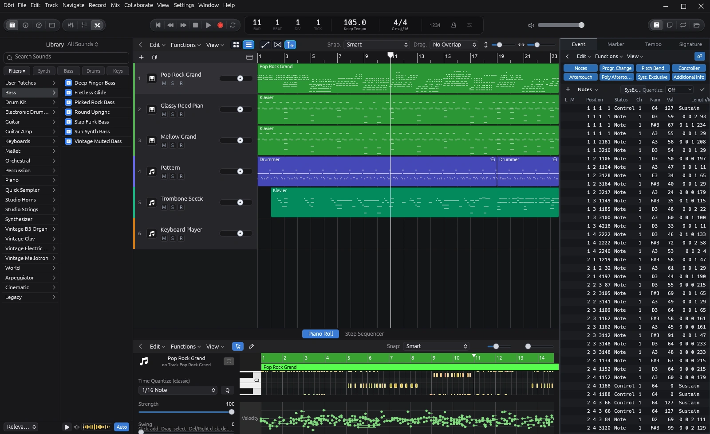
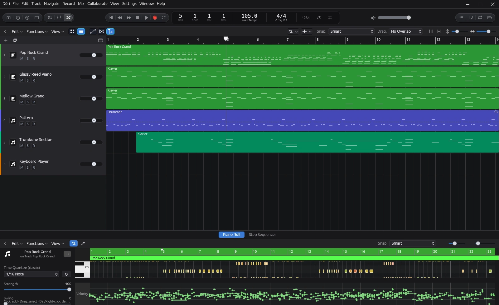
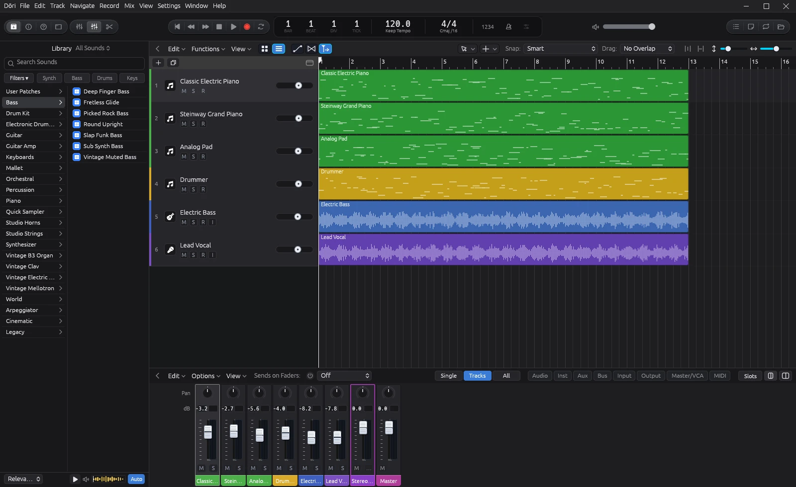

<p align="center"></p>

<h1 align="center">Dōri</h1>

<p align="center"><b>A pure-Rust digital audio workstation built Linux-first with cross-platform desktop support.</b></p>

<p align="center">Sample-accurate transport, MIDI and audio editing, a Piano Roll, a Mixer with real-time DSP effects and automation, and a lock-free audio engine. Rendered with egui and played through cpal (PipeWire/ALSA on Linux, WASAPI on Windows, CoreAudio on macOS), without Electron or JUCE.</p>

<p align="center"><i>Named after the Japanese <b>dōri</b> (道理)</i></p>

<p align="center">
  
  
  
</p>
<p align="center">
  <a href="https://github.com/triadwoozie/douri/releases/latest">
    
  </a>
</p>
<p align="center">
  <a href="#features">Features</a> •
  <a href="#quick-start">Quick Start</a> •
  <a href="#sound-libraries">Sound Libraries</a> •
  <a href="#architecture">Architecture</a> •
  <a href="docs/specs/AUDIT_AND_PLAN.md">Audit & Plan</a> •
  <a href="ROADMAP.md">Roadmap</a> •
  <a href="AGENTS.md">Contributing</a> •
  <a href="#credits--license">Credits & License</a>
</p>



<table>
  <tr>
    <td></td>
    <td></td>
  </tr>
  <tr>
    <td align="center">Piano Roll with quantize and velocity lane</td>
    <td align="center">Playback with live channel meters</td>
  </tr>
</table>

## Status

How much of the app works today, counted from the source: a menu entry is done when it can be
used, and a roadmap item when it is ticked in [`ROADMAP.md`](ROADMAP.md). Run `cargo xtask status`
to update this section.

<!-- status:start (made by `cargo xtask status`) -->


| | Done | Started | Total | Done % |
| --- | ---: | ---: | ---: | ---: |
| Menu entries | 227 | 0 | 334 | 67.96% |
| Roadmap items | 8 | 0 | 27 | 29.63% |
<!-- status:end -->

Dōri handles arranging, recording, editing, mixing, and bouncing in a single window on an engine built so the audio thread never blocks.

> **Note:** Dōri is alpha software. The project file format can still change, so keep backups of your work. Additional instruments and workflow features are listed in [`ROADMAP.md`](ROADMAP.md).

## Features

### Real-Time Engine & Audio Safety
- **Lock-free audio engine**: Sample-accurate transport with cycle looping, metronome, count-in, and tempo/time signature mapping (including compound and odd meters like 6/8 and 7/8).
- **Zero audio-thread allocation**: Audio processing paths enforce `#![forbid(alloc)]` and `assert_no_alloc`, avoiding heap allocations, mutexes, and blocking I/O on the real-time thread.
- **64-bit float summing & Plug-in Delay Compensation (PDC)**: 64-bit summing bus with automatic sample-accurate delay compensation across tracks and effect chains.
- **Native Windows ASIO & Low-Latency WASAPI**: Protocol-level Windows ASIO driver enumeration and streaming without proprietary Steinberg SDK headers, alongside `IAudioClient3` shared/exclusive low-latency period selection.
- **Linux PipeWire-Native JACK & Quantum Diagnostics**: Automatic detection of PipeWire's own `libjack.so.0` eliminating the need for `pw-jack` wrappers, with live buffer, period, and quantum metrics in Settings.
- **Loopback Round-Trip Latency Calibrator**: Band-limited Hann click pulse emission and normalized cross-correlation peak finding for hardware recording alignment calibration.
- **Privacy-Scrubbed Diagnostics (`douri --report`)**: CLI command that dumps system, kernel, audio stack, and device facts with home folder and username redaction for GitHub bug reporting.

### Arranging & Editing
- **Per-Note Pitch Editor**: Piano-roll pitch and formant editor for monophonic audio regions with cent-level pitch adjustments, entry/exit pitch drift curves, vibrato modulation, note gain leveling, scale snapping, and audio-to-MIDI conversion using pure-Rust PSOLA resynthesis.
- **Marquee Selection Tool**: Time-slice selection, split (`Cmd/Ctrl+T`), and region drag or delete across tracks.
- **Gap-Free Snap Grid**: Musical snapping to bars, beats, and division intervals without unintended micro-gaps or overlaps.
- **Option/Alt-Drag Duplication**: Region cloning in the tracks area with Alt/Option-drag.
- **Autosave & Crash Recovery**: Periodic background state snapshotting with session restoration prompts on startup.
- **Multi-Track Arranger**: Audio, Instrument, Drummer, Pattern, Aux, VCA, Folder, and External MIDI tracks with move, repeat, cut, copy, paste, split, join, bounce in place, and infinite undo history.

### Instruments & Sound Engines
- **Transient-Slicing Sampler**: Three-tab sampler (`Pads` 4×4 drum grid, `Slices` transient-detection loop slicer, and `Instrument` pitched multi-zone chromatic sampler) with pre-allocated lock-free voice structures.
- **Modal Voice Synthesizer**: Physical-modeling instrument with impulse, mallet, and noise burst exciters feeding up to 16 resonant bandpass modes with geometry, stiffness, and damping controls.
- **TripleOscillator (`TriOsc`)**: LMMS-inspired 3-oscillator subtractive synthesizer with Sine, Triangle, Saw, Square, Moog Saw, Exponential, and White Noise waves, per-oscillator coarse/fine detune, stereo phase offsets, and Mix, AM, PM, Sync, and FM modulation modes.
- **WaveDraw Wavetable Synthesizer**: BitInvader-inspired customizable wavetable synth with a 256-sample lookup table swapped lock-free between the UI and audio engine.
- **EXS & SFZ Multisample Player**: Multi-zone sample playback for `.exs` and `.sfz` instruments with 4-point cubic resampling, velocity layering, choke groups, and sample resolution across project folders and the user Sound Library path.
- **Dōri Essential Factory Kit**: Bundled CC-0 single-cycle geometric waveforms (`shapes/`) and electronic percussion one-shots indexed in the Sound Library.
- **Sound Library Management**: Configurable Sound Library root path under **Project Settings > General** with fallback searches for `.caf`, `.aif`, `.aiff`, `.wav`, and other standard audio formats.
- **808 Bass Synthesizer**: Sine-drop sub-bass synth with glide, tune, and saturation controls (`bass808.rs`).
- **SoundFont Player**: Built-in `.sf2` player supporting multi-sampled instruments with velocity layers and filter envelopes.
- **Electric Piano**: Reed-based physical model (Wurlitzer 200A style) with pickup saturation, tremolo, and tone bark.
- **Tonewheel Organ**: Additive drawbar organ with nine drawbars (16' to 1'), percussion harmonics, key click, and rotary speaker simulation.
- **Drum Machine**: 16-pad drum synthesizer (Kick, Snare, Hi-Hats, Toms, Claps) and custom sample loader with choke groups.
- **Subtractive Synthesizer**: 48-voice virtual analog polyphonic synthesizer with resonant filters and modulation routing.

### Built-In DSP Effects & Metering
- **Native Compressor**: Logarithmic gain reduction compressor with soft knee, stereo-linked sidechain detector, ballistic smoothing, makeup gain, and parallel dry/wet mixing.
- **Dynamic Modulation Links (Peak Follower & LFO)**: Real-time envelope follower for sidechain ducking and multi-waveform LFO for rhythmic parameter sweeps.
- **Lemon Studio Dynamics & Color Effects**:
  - **Lemon Limiter**: Lookahead peak limiter with transient punch.
  - **Lemon Soft Clipper**: Saturating soft clipper.
  - **Lemon Fast Distortion**: Harmonic overdrive stage with dynamic bite.
  - **Lemon Transient Processor**: Attack and sustain shaper for drums and stems.
- **SoundCraft Audio FX**:
  - **Bode Frequency Shifter**: Zero-alloc single-sideband frequency shifter with feedback.
  - **Auto-Pan**: Zero-alloc stereo panning modulator with rate, depth, and LFO waveform control.
- **Loudness & True Peak MultiMeter**: Analyzer window (**Window > MultiMeter**) with:
  - ITU-R BS.1770-4 K-weighted LUFS metering: Momentary (400 ms), Short-term (3 s), and Gated Integrated LUFS (-70 LUFS / -10 LU gates) with streaming (-14 LUFS) and broadcast (-23 LUFS) reference markers.
  - 4× oversampled polyphase windowed sinc True Peak filter with inter-sample peak clip indicator.
- **Mixer Channel Strips**: Master and Stereo Out strips show live Integrated LUFS and True Peak readouts.
- **Pult EQ**: Pultec-style tube EQ with low boost/attenuation and high shelf saturation.
- **Convolution Reverb**: Stereo convolution reverb with volume and filter envelopes, crossover, output EQ, presets, and custom impulse response (`.wav`, `.aiff`, `.flac`) loading.
- **Dynamics & EQ**: Channel EQ, Multi-Band EQ, Multi-Band Compressor, Compressor, Noise Gate, and Limiter.
- **Guitar & Bass Amp Sim**: Amplifier and cabinet simulation with drive and tone controls.
- **Modulation & Delays**: Tape Delay, Stereo Chorus, Phaser, Overdrive, and Resonant Filters.

### Export & Project Interoperability
- **Faster-Than-Realtime Offline Bounce**: Headless freewheeling mixdown at CPU memory speeds (up to 500× real-time) for full projects and cycle ranges.
- **Multi-Format WAV & TPDF Dithering**: 16-bit, 24-bit, and 32-bit float exports with Triangular Probability Density Function (TPDF) dithering via Xorshift32 PRNG (bypassing digital silence) and atomic `.part` file writes.
- **Stem Export**: **File > Export > All Tracks as Audio Files…** for concurrent offline multi-track stem rendering.
- **Project Import**: Import support for `.logicx` project bundles, `.band` projects (audio), Hydrogen `.h2song` drum patterns, and standard MIDI files (`.mid`).
- **Score Editor & MusicXML**: Sheet music view with key signatures, clefs, and MusicXML export.

### Plug-in Hosting & Management
- **Third-Party CLAP & VST3 Instrument Hosting**: Host software instrument synths and samplers alongside built-in instruments with zero-allocation MIDI event routing (Note On/Off, Pitch Bend, CC, Aftertouch, Sustain).
- **Native Linux Plugin Windows (X11 / XWayland)**: Dynamically embedded native GUI windows via `libloading` with zero compile-time X11 linker dependencies, accessible from mixer channel strips and the track inspector.
- **Plug-In Manager & Custom Scan Paths**: Searchable manager (**Settings > Plug-In Manager…** or **Window > Plugin Manager**) with category filters (All / Instruments / Effects), format filters (CLAP, VST3, AU, LADSPA), status reporting (Working, Incompatible, Crashed), and custom scan paths.

### Vulkan, Liquid Glass UI & MCP Server
- **Vulkan (`wgpu`) Graphics Backend**: Native Vulkan GPU rendering via `eframe` (`Renderer::Wgpu`) with automatic fallback to OpenGL (`Renderer::Glow`) in headless or CI environments.
- **Liquid Glass Floating Capsules**: WGSL shader pipeline for floating capsules, utility dialogs, and top bar controls.
- **Matte Obsidian Workspace**: Dark palette (`#0D0F14` canvas, `#13161E` panels, `#1A1E29` cards/capsules) with radial-arc pan knobs and channel faders.
- **Built-in Model Context Protocol (MCP) Server**: Zero-alloc real-time safe MCP bridge over local TCP (`127.0.0.1:38420`) and `--mcp-stdio` CLI mode, exposing 4 live resources and 19 automation and control tools.

### Local AI Stem Separation & Workflow Tools
- **100% Local AI Stem Separation (`Mix > Stem Splitter…`)**: Separates any imported audio region (`.wav`, `.mp3`, `.flac`, `.ogg`, `.m4a`, `.aiff`) into 4 playable stem tracks (**Vocals**, **Drums**, **Bass**, **Other**) on a background worker thread without blocking the audio or UI thread.
  - **Built-in Local AI Hybrid**: Works 100% offline out of the box with zero external downloads (STFT + HPSS + Mid/Side Wiener masking).
  - **Local ONNX Neural Models (`ort` + `tract-onnx`)**: Supports local `.onnx` models (such as **HTDemucs v4**) with hardware-optimized ONNX Runtime (`onnxruntime.dll`) and pure-Rust `tract-onnx` fallback, plus one-click local model download to `%LOCALAPPDATA%\douri\models\` (Windows) or `~/.local/share/douri/models/` (Linux/macOS).
  - **De-Bleed / Spill Reducer (0%–100%)** and **Extract Drum Kit & Groove** (slices drum transients into `.wav` + `.sfz` and generates a MIDI drum track).
- **Command Palette (`Ctrl+K` / `:`)**: Fuzzy-search modal for quickly triggering menu actions and tools.
- **Modulation Drawer (`MOD`) & Git A/B Audition (`A/B`)**: Quick-access transport toggles for per-track modulation routing and A/B project auditioning.
- **Stress Bench & PDC Inspector (`Diagnostics…`)**: Built-in audio engine stress benchmarking and Plug-in Delay Compensation inspection window.

## Quick Start

### Prerequisites (Linux)

Install the required ALSA and system development packages:

```bash
# Debian / Ubuntu / Pop!_OS / Linux Mint:
sudo apt-get update && sudo apt-get install -y pkg-config libasound2-dev libxkbcommon-dev libwayland-dev

# Fedora / Nobara / RHEL:
sudo dnf install -y pkgconf-pkg-config alsa-lib-devel libxkbcommon-devel wayland-devel

# Arch Linux / Manjaro:
sudo pacman -S --needed pkgconf alsa-lib libxkbcommon wayland

```

### Prerequisites & Setup (Windows)

- **Installer / Portable**: Run `dist/Dori-Setup-<version>-x86_64.exe` (or extract `dist/Dori-Portable-<version>-Windows-x86_64.zip`). Both include `douri.exe` and `onnxruntime.dll` for hardware-accelerated local AI stem separation.
- **Building from Source on Windows** (using `x86_64-pc-windows-gnu`):
  1. Install Rust via [rustup](https://rustup.rs/) with the `x86_64-pc-windows-gnu` toolchain.
  2. Install WinLibs MinGW-w64 (provides `gcc`, `as`, `dlltool`, `windres`):
     ```powershell
     winget install -e --id BrechtSanders.WinLibs.POSIX.UCRT
     ```
  3. Build and run:
     ```powershell
     cargo build --release -p douri --bin douri
     ```

### Build & Run from Source

```bash
# Clone the repository
git clone [https://github.com/triadwoozie/douri.git](https://github.com/triadwoozie/douri.git)
cd douri

# Run Dōri in release mode
cargo run --release --bin douri

# Open a specific project or audio file
cargo run --release --bin douri -- my_project.douri
cargo run --release --bin douri -- song_stems.wav

```

### Desktop Integration & Installation (Linux)

To install Dōri, its desktop launcher, MIME file types, and application icons to `~/.local`:

```bash
# Build the release binary
cargo build --release --bin douri

# Run the install script (no root required)
./dist/linux/install.sh

```

To uninstall:

```bash
./dist/linux/install.sh --uninstall

```

### Running Tests & Audio Safety Verification

```bash
# Run workspace test suite
cargo test --workspace

# Run real-time audio thread allocation checks (validates zero allocations)
cargo xtask rt-check

# Run full project checks
cargo xtask check

```

## Sound Libraries

Dōri loads soundfonts, sample libraries, and impulse responses:

* **SoundFonts (`.sf2`)**: Drop `.sf2` files into `~/.local/share/soundfonts/` or load them via the track Inspector under **SoundFont > Load SoundFont…**.
* **EXS & SFZ Libraries**: In the track Inspector, select **SoundFont > Sampler** and choose **Load SFZ Instrument…** or **Load EXS Instrument…**.
* **Impulse Responses**: Open Convolution Reverb from any Audio FX slot, click the IR menu, and choose **Load Impulse Response File…** (`.wav`, `.aiff`, or `.flac`).

## Architecture

| Crate | Purpose |
| --- | --- |
| [`crates/prowave-engine`](https://www.google.com/search?q=crates/prowave-engine) | Real-time audio engine: sample-accurate transport, lock-free queues, 64-bit mixer, offline freewheeling bounce, EBU R128 metering, synths, and cpal output |
| [`crates/prowave-app`](https://www.google.com/search?q=crates/prowave-app) | Desktop interface built in `egui`: tracks area, Piano Roll, Mixer, MultiMeter, and inspector |
| [`crates/prowave-project`](https://www.google.com/search?q=crates/prowave-project) | Project serializer & archive container (`.douri` zip package with `.prowave` backward compatibility) |
| [`crates/prowave-plugin-host`](https://www.google.com/search?q=crates/prowave-plugin-host) | Out-of-process and in-process plugin hosting for CLAP, VST3, LADSPA, and AU |
| [`crates/prowave-logicx-import`](https://www.google.com/search?q=crates/prowave-logicx-import) | Importer for `.logicx` project bundles |
| [`crates/prowave-garageband-import`](https://www.google.com/search?q=crates/prowave-garageband-import) | Importer for `.band` project bundles |
| [`crates/prowave-exs`](https://www.google.com/search?q=crates/prowave-exs) | `.exs` sampler instrument parser: zones, groups, loops, and velocity layers |
| [`crates/prowave-sfz`](https://www.google.com/search?q=crates/prowave-sfz) | `.sfz` instrument format reader |
| [`xtask`](https://www.google.com/search?q=xtask) | Build tooling: `cargo xtask check`, `rt-check`, `bench`, and `wasm-check` |

## Credits & License

Copyright (C) 2026 Dōri contributors.

Original work Copyright (C) 2026 Pro-Wave contributors.

Dōri is free software: you can redistribute it and/or modify it under the terms of the **GNU General Public License** as published by the Free Software Foundation, either version 3 of the License, or (at your option) any later version (**GPL-3.0-or-later**).

Per **Section 5 of the GNU General Public License v3**, Dōri attributes and builds upon the following open-source projects:

* **[fabox-os/Pro-Wave](https://github.com/fabox-os/Pro-Wave)** (GPL-3.0-or-later): Upstream core DAW architecture, real-time lock-free engine, egui user interface, and built-in DSP effects.
* **[transit-audio/transit](https://github.com/transit-audio/transit)** (MIT / Apache-2.0): SDK-free Windows ASIO/WASAPI protocol backends, PipeWire loader discovery, crash-safe privacy-redacted diagnostics, loopback latency calibrator, Modal Voice synthesizer, and dynamics compressor.
* **[LMMS/lmms](https://github.com/LMMS/lmms)** (GPL-2.0-or-later): TripleOscillator (TriOsc) 3-oscillator synth architecture, BitInvader-inspired WaveDraw wavetable synth, Peak Follower & LFO modulators, and CC-0 single-cycle geometric waveform assets (`shapes/`).
* **[yuribeats/prowave](https://github.com/yuribeats/prowave)** (GPL-3.0-or-later): Yuri's Version arranging tools (Marquee selection, snap grid, Option-drag), crash recovery, and 808 Bass synthesizer.
* **[storytold/soundcraft](https://github.com/storytold/soundcraft)** (MIT / Apache-2.0): Faster-than-realtime offline mixdown architecture, TPDF dither generator, and ITU-R BS.1770 / EBU R128 True Peak and loudness metering.
* **[Ardour](https://github.com/Ardour/ardour)** (GPL-2.0-or-later): Hardware MIDI patch definition library (`.midnam`) and Scala microtonal tuning references.
* **[DAW UI Design](https://www.figma.com/community/file/1240550915764011777/daw-ui-design)** (CC BY 4.0, Dicky Jiang): Modern flat-bevel vector rotary knob and DAW hardware control styling reference.
* **[webaudio-controls](https://github.com/g200kg/webaudio-controls)** (Apache-2.0, g200kg, Eiji Kitamura, Ryoya Kawai, and Keisuke Ai): Hardware rotary, slider, and keyboard control ergonomics and inline parameter editing patterns.
* **[Phosphor Icons](https://phosphoricons.com/)** (MIT License, Helena Zhang & Tobias Fried): Vector studio icons via `phosphor-egui`.

All original copyright notices and license texts are retained. See [`THIRD_PARTY_LICENSES.md`](THIRD_PARTY_LICENSES.md) for third-party attributions, and [`LICENSE`](https://www.google.com/search?q=LICENSE) for complete terms.

Dōri is an independent open-source project and is not affiliated with, sponsored by, or endorsed by Apple Inc. `.logicx`, `.band`, and `.exs` are referenced solely to describe file format compatibility.
